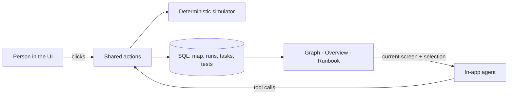

# BACKSTOP

**Test the way back in before you need it.**

BACKSTOP is a recovery-readiness simulator for small teams. You write down how your team signs in to, recovers, and administers its critical accounts. Then you rehearse a failure, such as *the administrator loses their phone*, and see exactly which systems you could still get into and why.

It is built on [Agent-Native](https://agent-native.com). The person and the AI agent work on the same saved map, through the same actions.

> **Demo video:** [Watch the 2½-minute walkthrough](https://drive.google.com/file/d/1hIoE2xSgLZ8Xy1_yxk9PcKybc_lpEs7h/view?usp=sharing) (music: Sascha Ende, ende.app, CC BY 4.0)<br>
> **Built for:** Builder.io Agent-Native hackathon, October 27 – November 9, 2026

---

## The problem

A ten-person company might run on Google Workspace, GitHub, AWS, a domain registrar, and a password manager. Each login looks independent. In practice many of them lead back to the same thing: one inbox, one phone, one person. Lose that, and several accounts go dark at once, and the recovery route for one may need access to another.

Most teams find this out during the incident. BACKSTOP lets you find it out on a Tuesday afternoon, without touching a single live account.

## What it does

1. **Map** how each service is reached. For every resource you record its *access*, *recovery*, and *administration* separately, and the routes that satisfy each one. A route can need **all** of its prerequisites or **any** one of them, and each link is marked *verified*, *assumed*, or *unknown*.
2. **Simulate** a failure: a lost phone, an unavailable inbox, a missing administrator, a locked vault, or any resource and capability you pick.
3. **Trace** the result on an interactive graph. Every capability gets a status, and clicking one highlights the exact chain that caused it.
4. **Ask the agent** what caused an impact. It answers from the saved run, never from guesswork.
5. **Fix** it: record the task, add the independent route once it exists, and run the scenario again to see the blast radius shrink.
6. **Prove** it: a person records each recovery test. Until then, every route is labelled *documented, not tested*.
7. **Print the runbook**, an emergency document generated only from what is recorded.

## The 90-second walkthrough

The app ships with **Northstar Studio**, a fictional sample team.

| Step | What you see |
|---|---|
| **Lost administrator phone** | 5 capabilities blocked: the phone, Workspace email, Code repository, Cloud infrastructure, Password vault. The domain registrar survives, because its route accepts *phone or hardware key*. |
| **Click Workspace email → Show path** | The causal chain lights up on the graph; everything else dims. |
| **Ask agent to explain** | A grounded explanation that cites the stored run and calls it a model result, not live provider state. |
| **"Create a task for this"** | The agent records a remediation task. It appears on the Remediation screen at once; the map is unchanged. |
| **Add the hardware-key route to email, run again** | Only the phone stays blocked. A recovery loop between email and vault stays flagged, and is not called a lockout. |
| **Runbook** | A numbered, printable document with every recorded way in, the gaps, the latest run, open tasks, and test history. |

Full deploy and recording steps: [docs/DEPLOY_AND_DEMO.md](docs/DEPLOY_AND_DEMO.md).

## How the simulation works

The engine is plain, deterministic TypeScript in [`shared/simulate.ts`](shared/simulate.ts). **No language model computes a status.** The same map and the same failure always give the same result, path, and wording.

| Status | Meaning |
|---|---|
| **Available** | At least one recorded route works *under the assumptions you entered*. It does not mean the real service is up. |
| **Blocked** | Every recorded route is blocked. |
| **At risk** | The outcome hangs on an *assumed* link. An assumed link alone never confirms a block. |
| **Unknown** | Something is not recorded. Missing information is never treated as safe. |

Rules the engine follows:

- An **ALL** route fails if any prerequisite fails; an **ANY** route survives while one alternative does. Separate routes for one capability are alternatives.
- Status is **per capability**. Recovery being available does not make access available.
- A dependency **cycle** is reported as a potential recovery loop. It is a warning, not proof of lockout.
- Every run is **saved as a snapshot**. Editing the map later never rewrites a past result.

The engine has 15 unit tests covering ALL/ANY logic, alternative routes, multi-hop cascades, unknowns, cycles, and the Northstar before/after outcome.

## What makes it agent-native

The agent is not a chatbot bolted onto a dashboard. It uses the **same 17 domain actions** as the UI, on the same database, under the same permissions:



- **One source of truth.** `run-simulation`, `add-dependency-route`, `create-remediation-task`, `get-runbook`, and the rest are defined once with `defineAction()`. The graph's buttons and the agent's tools both call them.
- **Screen-aware.** The agent knows which run and which resource you are looking at. "Ask agent to explain" hands it the visible run id, and it reads that run before answering.
- **Bounded on the server.** The agent can *plan* a recovery test, but the server refuses any *passed* or *failed* result that does not come from a person in the app who confirms they performed or watched it. A database constraint enforces the same rule. Asked to mark a test passed, the agent is refused and tells you to record it yourself.
- **Honest receipts.** Every write returns what changed, and says plainly when the map or a provider was *not* changed.

## Trust and safety

- **No credentials, ever.** BACKSTOP never signs in to GitHub, AWS, Google, or anything else, and stores no passwords, codes, or keys. Text that looks like a credential is rejected on save.
- **No claims it cannot back.** The runbook never invents a procedure; missing data reads *not recorded*. Nothing is marked tested unless a person tested it.
- **Workspace isolation.** Every read and write is scoped to the signed-in team. `pnpm check:isolation` runs two synthetic users through every action and confirms each cross-team attempt is refused, including direct access by task or test id.

## Screens

| Route | Purpose |
|---|---|
| `/home` | **Overview.** A plain sentence restating the latest run, and a ledger showing how many ways in each system has, what it depends on, and whether it has been tested. |
| `/map` | **Dependency map.** Scenario picker, interactive graph with status overlay and causal-path highlighting, and an inspector for editing routes and recording tests. A list view replaces the graph on narrow screens. |
| `/remediation` | **Tasks** with priority, status, owner, and the related resource and run. Completing a task never changes the map. |
| `/runbook` | **Emergency runbook.** Printable, with Markdown export. Labelled confidential. |

Light and dark themes; status is always shown with a word and a shape, never colour alone.

## Run it locally

Requires **Node.js 22.22+**.

```bash
git clone <this repo> backstop && cd backstop
corepack enable
pnpm install
pnpm dev
```

Open http://localhost:8080 and sign in with a local account. Choose **Open the sample team**. To use the agent, open the agent panel (top right) and connect a model through Builder.io or your own API key.

Local development uses an embedded database, so no setup is needed. Production needs PostgreSQL; see [docs/DEPLOY_AND_DEMO.md](docs/DEPLOY_AND_DEMO.md).

### Checks

```bash
pnpm typecheck            # TypeScript
pnpm test                 # 38 unit tests: simulator, runbook, scenarios, test-result rules
pnpm agent-native:doctor  # framework guards: scoping, migrations, access checks
pnpm check:isolation      # cross-workspace refusal, against the local database
```

## Where things live

```
shared/simulate.ts          Deterministic simulation engine (and its tests)
shared/runbook.ts           Runbook built from saved records, plus Markdown
shared/readiness.ts         Overview ledger and the plain-language run summary
shared/scenarios.ts         Failure presets, shown only when their resource exists
server/domain/              Database reads and writes, access checks, locking
actions/                    The actions shared by the UI and the agent
app/routes/                 Overview, map, remediation, runbook screens
app/components/map/         Graph, inspector, scenario rail, test recording
docs/fixtures/              The fictional Northstar Studio sample
docs/docs/                  Product and technical spec written before the build
```

## Built during the hackathon, and what was already there

**Pre-existing, not ours:**
- The [Agent-Native](https://agent-native.com) framework and its **Chat template**: app shell, sign-in, chat panel, sidebar, database plumbing, and the template actions `hello`, `navigate`, `view-screen`, `run`, and `provider-api-request`.
- Open-source libraries: React Flow (`@xyflow/react`) for the graph canvas, dagre for layout, Drizzle ORM, Zod, Tabler Icons, and the Inter and IBM Plex Mono typefaces.

**Built from November 2, 2026, in this repository:** everything specific to BACKSTOP. That includes the data model and migrations, the simulation engine, all 17 domain actions, the four screens, the runbook, recovery tests, the isolation check, and the Northstar Studio sample. The commit history (`git log`) shows each step, starting with the empty starter on November 2.

## Limitations

- BACKSTOP models what you tell it. It does not discover accounts or verify settings, and a simulation does not prove a real account can be recovered.
- Every route is manual input. There are no provider integrations, by design.
- Northstar Studio is fictional. Its routes are not statements about any real provider's defaults.
- It has not been penetration-tested.

---

*Synthetic sample data only. Never enter real recovery codes, passwords, or secrets.*
