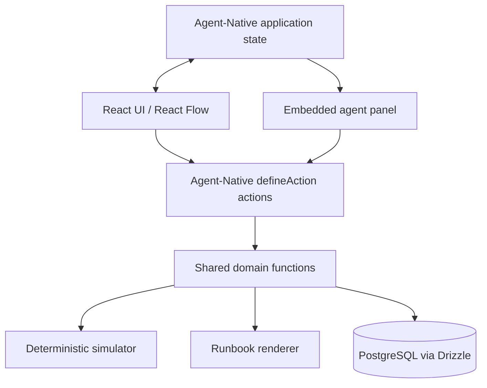

# Technical Architecture and Framework Integration

## 1. Verified official framework conventions

The Agent-Native official docs describe `@agent-native/core` actions declared with `defineAction()` and Zod schemas, invoked by both the agent and React UI; PostgreSQL/Drizzle for persistent domain data, PGlite in local development, application state for screen context, and an embedded agent panel. The Chat template is a practical starter.

Official references: https://www.agent-native.com/docs/creating-templates/ ; https://www.agent-native.com/docs/agent-surfaces/ ; https://www.agent-native.com/docs/server-database/

### Start from the official Chat scaffold

```bash
node --version # must satisfy current official minimum, presently 22.22+
npx --yes @agent-native/core@latest create backstop --standalone --template chat
cd backstop
corepack enable
pnpm install
pnpm dev
```

Read **the generated `AGENTS.md` and action/database examples**. Do not assume package internals are identical to illustrative files in this pack.

## 2. Recommended architecture



The database is the source of truth. No duplicated UI-only graph state for persisted information. UI may cache but must sync to action results.

## 3. Tech choices

| Concern | Choice | Notes |
|---|---|---|
| Framework | Agent-Native | Core framework required by event |
| Language | TypeScript | strict mode preferred |
| UI | React + Tailwind | match generated template conventions |
| Components | toolkit/shadcn-style | optional, avoid unnecessary rewrites |
| Graph canvas | `@xyflow/react` | explicit node/edge inspector |
| Database | PostgreSQL / PGlite | use scaffold adapter |
| ORM | Drizzle | keep migrations additive |
| Validation | Zod | parse all action inputs |
| Simulation | pure TypeScript | independent of agent inference |
| Output | in-app runbook + print/PDF | preserve workspace access controls |

## 4. Folder responsibilities (illustrative)

```text
actions/                 # defineAction wrappers, server-side auth + validation
app/routes/              # overview, map, simulation, remediation, tests, runbook
app/components/          # graph, inspector, cards, agent panel integration
lib/domain/              # business logic, no React dependencies
lib/simulation/          # deterministic engine + cycle detection
lib/runbook/             # source-grounded runbook document builder
server/db/schema.ts      # additive Drizzle schema
server/db/index.ts       # generated scaffold's DB helper
AGENTS.md                # repository agent instructions
.agents/skills/...       # domain skills
```

## 5. Action contract

Verified current docs show an action of the form:

```ts
import { defineAction } from '@agent-native/core/action';
import { z } from 'zod';

export default defineAction({
  description: 'Inspect the recovery dependency graph.',
  readOnly: true,
  schema: z.object({}),
  run: async (_args, ctx) => {
    // Derive actor / org from ctx; fetch authorized rows.
    return { resources: [], groups: [], links: [] };
  },
});
```

This is an **API shape example**, not complete production code. Refer to generated `server/db/index.ts`, tenancy/access helpers, polling and UI hooks to implement it.

## 6. Workspace and authentication

Use existing framework auth and sharing. The official docs show `ctx.userEmail` and `ctx.orgId` in action `run` context. Stamp records appropriately; enforce ownership on every referenced foreign key. Never trust workspace IDs provided by the agent as authority.

**Special case:** a public fictional demo workspace may be accessible without exposing any real team data. Keep demo/public data completely separate from private workspaces.

## 7. Application state

Use current framework navigation state (`useAgentRouteState` in official examples) to publish semantic view + selected resource/simulation ID. The agent should know which object “this” refers to. A `view-screen` read action should expose a safe screen snapshot. `navigate` may update app-state commands using documented conventions.

## 8. Simulation integration

- Action reads a *transaction-consistent* graph snapshot.
- Pure evaluator returns per-capability states, confidence and explanation paths.
- Action persists `simulation_runs` and `simulation_impacts` transactionally, including graph version/snapshot where practical.
- UI visualizes persisted result, not generated prose as truth.
- Agent explains persisted result and cites source nodes/paths.

## 9. Provider/model configuration

Agent-Native supports configurable AI providers; use the current starter's supported setup. Store provider keys only in the framework's approved server-side credential storage/environment. **Do not put API keys in sample fixtures or source control.**

## 10. Environment and deployment

- Local: use scaffold's default database (often PGlite) for rapid development.
- Production: persistent PostgreSQL, Node-compatible deployment, secured secrets and backups.
- Deploy early enough to verify an actual public demonstration flow.
- Avoid unnecessary queues, search indexes, microservices, OAuth connections and background polling for the MVP.

## 11. Error handling and observability

Return stable error codes (`NOT_FOUND`, `FORBIDDEN`, `VALIDATION_ERROR`, `SIMULATION_ERROR`). Record non-secret action telemetry and scenario trace IDs; do not log sensitive notes or provider credentials. Add loading/error/empty feedback.
